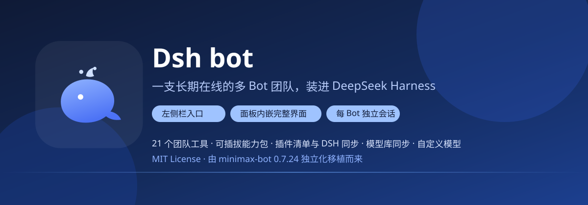
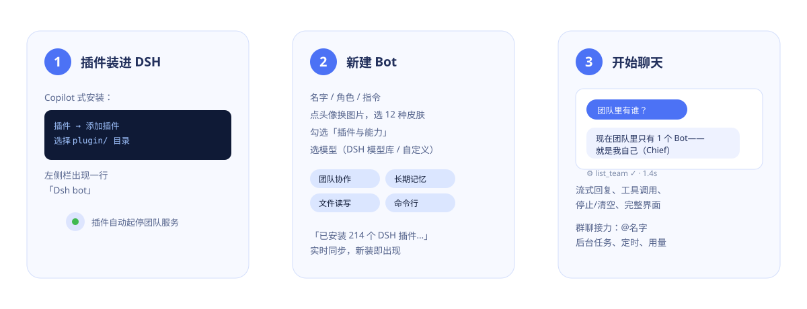
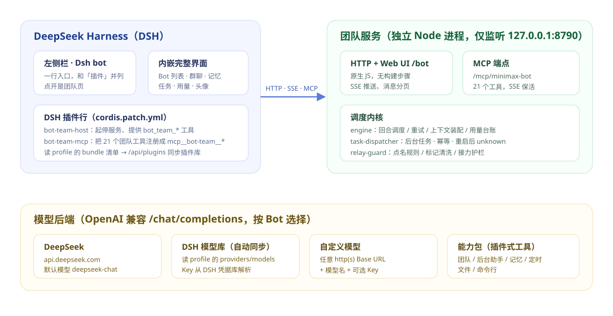

<div align="center">
  
</div>

# Dsh bot

**把一支长期在线的多 Bot 团队，装进 DeepSeek Harness。**

左侧栏一行入口 → 面板里就是完整团队界面：每个 Bot 有自己的会话、头像与能力；Bot 之间可以私聊派活、
拉群 `@名字` 接力、跑后台任务、记长期记忆、定时执行，全部通过 21 个 MCP 工具暴露给 Agent。
不需要另开网页、不需要另配一套 Key。

[](LICENSE)
[](https://nodejs.org/)
[](#测试)

<p align="center"></p>

---

## 这是什么

它由两部分组成，装一次就都有了：

| 部分 | 目录 | 作用 |
|---|---|---|
| **DSH 插件** | [`plugin/`](plugin) | 左侧栏一行「Dsh bot」、内嵌完整界面、自动起停团队服务、把 21 个团队工具注册成 `mcp__bot-team__*` |
| **团队服务** | [`service/`](service) | 独立 Node 进程：回合调度、任务与批次、群接力护栏、长期记忆、用量台账、Web UI、MCP 端点 |

> 团队服务是 `minimax-bot 0.7.24`（MIT）的独立化移植：保留它全部产品行为与 21 个 MCP 工具契约，
> 把原来依赖 MiniMax Code 宿主的部分换成自带宿主 + 自研 DeepSeek Agent 运行时。
> 逐条差异与原因见 [`docs/与原实现的差异说明.md`](docs/与原实现的差异说明.md)。

<p align="center"></p>

## 亮点

- **真的在 DSH 里**：左侧栏入口 + 面板内嵌界面，不跳转、不开新窗口。
- **每 Bot 独立会话**：私聊互不可见；群里靠 `@名字` 接力，点名规则、标记清洗、跳数上限都按原实现保留。
- **可插拔能力包**：新建 Bot 时勾选「团队协作 / 后台助手 / 长期记忆 / 定时任务 / 文件读写 / 命令行」，
  没勾的能力**既不出现在工具目录里，也无法被调用**。
- **插件清单与 DSH 同步**：读 profile 的 bundle 清单 → 每个 bundle 的 `cordis.patch.yml` → profile 覆盖层，
  实时显示「已安装 214 个插件，这些能给 Bot 用」，新装插件下次开表单即出现。
- **模型库同步 + 自定义模型**：自动同步 DSH 已配置的 providers/models（Key 从 DSH 凭据库解析），
  也可以给某个 Bot 配任意 OpenAI 兼容的 Base URL、模型名与 Key。
- **头像可自定义**：默认小鲸鱼，12 种皮肤，或上传自己的图片（自动裁成 256px，存本地头像库、跨 Bot 复用）。
- **可靠**：原子写 + fsync、崩溃恢复、`unknown` 不重放、幂等 `request_id`、用量只记真实运行时长。

## 三步上手

### 1. 装插件

DSH → **插件** → **添加插件** → 选择本仓库的 `plugin/` 目录（它会把团队服务一起管起来）。

插件安装后会自动：

- 需要时拉起团队服务（默认 `127.0.0.1:8790`，只监听本机）；
- 通过 `@deepseek-ai/dsh-mcp-client` 把 21 个工具注册给 Agent；
- 在左侧栏放一行 **Dsh bot**。

### 2. 配模型 Key

任选其一：

```bash
# A. 让团队服务用 DSH 的模型库（默认；Key 从 DSH 凭据库读，不用另填）
#    什么都不用做，插件启动时已同步

# B. 给团队服务自己的配置（独立部署时用）
cd service && cp config.example.json config.json
# 编辑 config.json：api.apiKey / api.baseURL / api.model
node bin/dsteam.mjs --port 8790
```

### 3. 建 Bot，开聊

左下 **Dsh bot** → 「新建 Bot」→ 填名字/角色/指令 → 点头像换头像 → 勾能力 → 选模型 → **创建并开始聊天**。
然后直接和它说：「团队里有谁？」「帮我写一句产品 slogan」「让 Chief 建一个产品经理 Bot」。

## 内置能力包

| 能力包 | 解锁的工具 |
|---|---|
| `team` 团队协作 | `list_team`、`message_bot`、`dispatch_tasks`、`get_tasks`、`cancel_tasks`、`post_group`、`create/update/delete_bot`、`create/update/delete_group` |
| `helpers` 后台助手 | `start_helper`、`list_helpers`、`stop_helper` |
| `memory` 长期记忆 | `remember`、`recall`、`forget` |
| `schedule` 定时任务 | `create_schedule`、`list_schedules`、`delete_schedule` |
| `files` 文件读写 | `read_file`、`write_file`、`edit_file`、`list_dir` |
| `shell` 命令行 | `run_command` |

主 Bot 始终保留 `team`；全不勾 = 纯聊天 Bot；不填字段的老 Bot 等价于「全部」，行为不变。

## 目录

```
plugin/            DSH 插件（index.js 宿主半边 · client.js 界面半边 · cordis.patch.yml）
service/           团队服务
  bin/dsteam.mjs     CLI 入口（独立运行 / 插件拉起都用它）
  miniapp/node/      服务端：engine · task-dispatcher · relay-guard · memory · mcp · store
  miniapp/client/    Web UI（原生 JS，无构建）
  tests/             433 个 node:test 用例
docs/              架构、移植差异说明、插件详情
```

## 独立运行（不装 DSH 插件也能用）

```powershell
cd service
Copy-Item config.example.json config.json   # 填 api.apiKey
node bin/dsteam.mjs --port 8790
# 打开 http://127.0.0.1:8790/bot
```

MCP 客户端可直接接 `http://127.0.0.1:8790/mcp/minimax-bot`（见 `service/servers.mcp.json`）。

## 测试

```bash
cd service/tests && npm install --no-audit --no-fund
node --test                    # 433 个用例全绿
node ../service/tests/_integration-smoke.mjs   # 端到端：真进程 + 脚本化模型后端
```

覆盖：调度与重试、任务状态机与重启、群接力与点名、记忆与上下文预算、存储原子性、
HTTP/SSE、客户端渲染（jsdom）、能力包裁剪、插件清单解析、模型库同步。

## 安全边界

- 团队服务只监听 `127.0.0.1`，**没有登录鉴权**：本机任意进程都能访问，不要端口转发到公网。
- `run_command` / 文件工具限制在 Bot 自己的工作目录（`workspaceRoot`）内，不是安全沙箱。
- MCP 的 `caller_bot_id` 由调用方自报，是行为约束而不是安全边界（沿用原实现）。
- 自定义模型的 Key 以明文存在 `service/data/state.json`（本地数据目录）；不想落盘就用服务端默认 Key。

## 许可

MIT。本仓库是 `minimax-bot 0.7.24`（Copyright (c) 2026 MiniMax，MIT）的衍生作品，保留原版权声明与许可声明；
本移植新增部分同样以 MIT 发布。详见 [LICENSE](LICENSE)、[NOTICE](NOTICE) 与
[`docs/与原实现的差异说明.md`](docs/与原实现的差异说明.md)。

> 产品名称为 **Dsh bot**；`MiniMax Bot`、`minimax-bot`、`MiniMax Code` 是其各自权利人的名称/商标，
> 本项目仅用来说明来源。为兼容既有客户端与旧数据，MCP 端点路径（`/mcp/minimax-bot`）、
> `serverInfo.name` 与工具前缀 `mcp__minimax-bot__` 保持原样。

